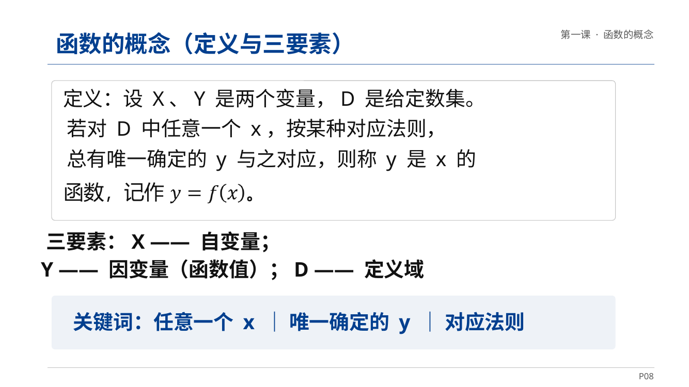
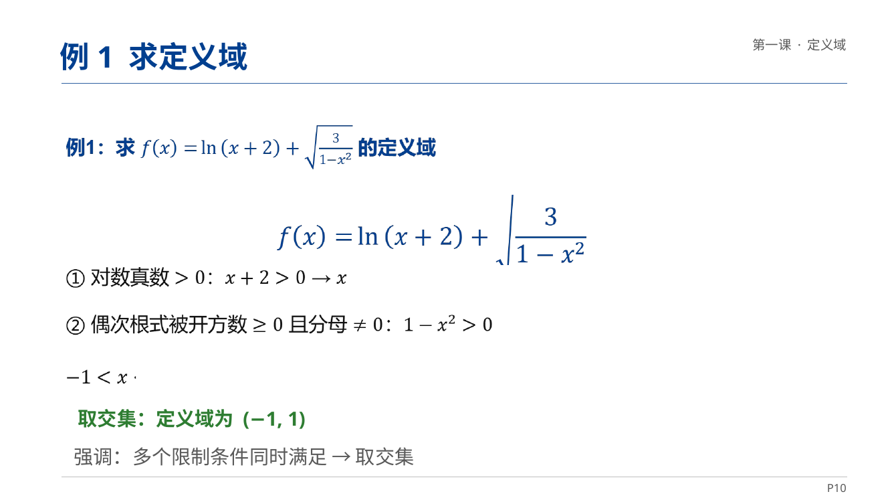
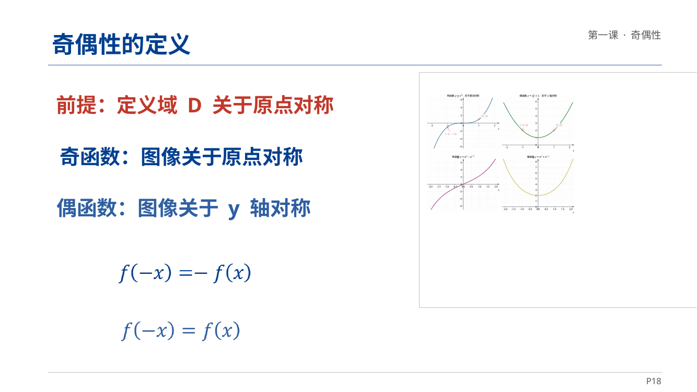
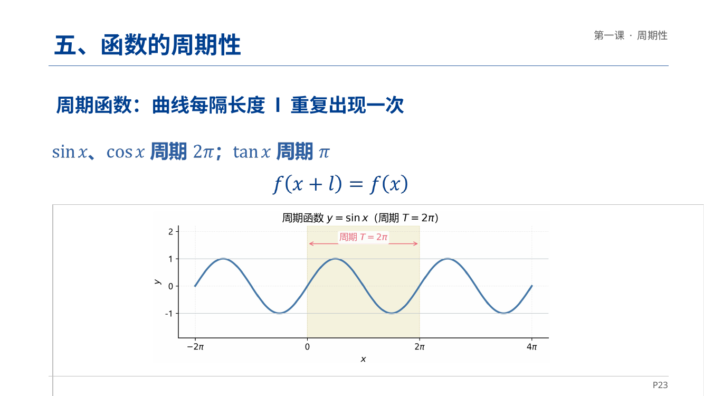

# shuxueppt — 中文数学教学 PPT 生成与检修技能

   

面向中文数学课件（导数、极限、积分等）的生产与检修技能，覆盖两种任务：**从教案 / 练习册批量生产数学课件**，以及**对既有课件做质量检查与修复**。它既是一份给 AI 助手用的技能说明（`SKILL.md`），也是一套可直接跑的纯 Python 检查与修复脚本。

## 效果展示

以下截图来自作者制作的课件《函数及其性质（一）》（共 28 页），展示本技能所面向的课件形态：概念、例题、图像与课堂小结齐全，公式用真 OMML 结构，同一份文件在 PowerPoint 与 WPS 里都要显示完整。

| 封面 | 函数概念 |
|---|---|
|  |  |

| 例题：求定义域 | 奇偶性定义 |
|---|---|
|  |  |

| 周期性 | 课堂小结 |
|---|---|
|  |  |

## 一句话标准

**同一份 `.pptx` 在 PowerPoint 和 WPS 里都要显示完整、公式结构正确、答案不压题干。** 只看 PowerPoint 通过不算完成。

这个标准来自一个真实教训：很多课件在 PowerPoint 里看着正常，在 WPS 里公式和文字却整块消失。根因往往不是内容没写进去，而是公式的 OOXML 结构非法，WPS 不认。

## 适合谁用

- 按课次批量生产数学课件的老师、教研人员：导入 → 概念 → 例题 → 随堂练习 → 小结，一课一份。
- 手头已有课件，但出现“内容缺失、极限写得不对、分式是斜杠、指数掉下来了、答案压住题目、排版越界”的老师。
- 交付前想做一次全量体检和回归验证，不想凭肉眼翻页碰运气的人。

## 核心方法：先量，再改；改完必须回归验收

不要凭肉眼翻页判断。先用检查器把所有缺陷量化成清单，按缺陷族归类，再逐族修。改完必须回归验收，证明“该修的都修了，没修的没坏”。

```bash
# 1. 体检：产出 issues.json（机器读）、report.md（人读）
python scripts/inspect_pptx.py --decks "<课件目录>" --out "<输出目录>"

# 2. 结构合法 + 数学不丢失（与备份逐页比 oMath 计数）
python scripts/verify_integrity.py --decks "<课件目录>" --baseline "<备份目录>"

# 3. 双引擎渲染比对（需要 Windows + PowerPoint + WPS）
python scripts/compare_render.py --decks "<课件目录>" --baseline "<备份目录>" \
       --engines ppt,wps --out "<输出目录>"
```

验收通过标准：PowerPoint 逐页墨迹变化 0 页超过 2%；WPS 逐页墨迹修复后 ≥ 修复前；每页 `<m:oMath` 计数不低于基线；无“答案压住另一道题”的实例。**如果 WPS 侧墨迹没有上升，说明没修到根因**，要回到单变量实验，不要继续叠加改动。

## 能检出、能修的缺陷族

按严重度排序，完整判定规则与真实样例见 `references/defect-catalogue.md`。

| 族 | 代码 | 现象 | 根因 |
|---|---|---|---|
| 公式结构非法 | `M-BADNEST` | WPS 里公式整块消失，PowerPoint 正常 | `m:oMathPara` 里嵌了 `a14:m` |
| 内容为空 | `M-EMPTYMATH` / `M-FUNCARG` / `M-EMPTYFRAC` | 公式空白、`sin` 无自变量、分式分子分母空 | 转换时结构丢失 |
| 极限 | `L-AS-SUB` | `lim` 的趋近条件缩成右下角小脚标 | 用 `m:sSub` 而非 `m:limLow` |
| 指数 | `E-SPLITRUN` | `x3/2`、`e−x` 平排 | 指数被切成独立 run，靠 `baseline` 硬抬 |
| 分式 | `F-LINEAR` / `F-IN-TEXT` | `1/x`、`π/2` 斜杠平写 | 该做分式对象的地方留了 `/` |
| 版式 | `O-COLLIDE` / `O-OFFCANVAS` | 答案压题干、形状越出画布 | 坐标错位 |
| 潜在兼容风险 | `M-BLANKFB` | 对 WPS 无实测影响 | 见下方警告 |

修复顺序（由“看不见”到“不好看”，每一步都要过数学计数守护）：

1. 公式结构非法 → `scripts/fix_invisible.py --nest`（拆 `oMathPara` 内的 `a14:m`，**这是真正修复 WPS 缺内容的一步**）
2. 极限表示 → `scripts/fix_limit.py`（`m:sSub` 重建为 `m:limLow`）
3. 空结构 → `scripts/fix_empty_math.py`（空 `m:func` 外壳、空分式）
4. 指数 → `scripts/fix_exponent.py`（拆散 run 合成真 `m:sSup`）
5. 版式 → `scripts/audit_overlap.py` 定位，再手工或改坐标挪位
6. 可选 → `scripts/fix_invisible.py --unwrap`（展开空 Fallback，仅当目标读者可能是老版本 Office 等不支持 a14 的软件时）

所有修复脚本默认 **dry-run**，加 `--write` 才落盘；每个脚本内置“每页 `<m:oMath` 数不得减少”断言，触发即中止。

## 两个不要误判的警告

- **不要假设“空 Fallback 导致 WPS 缺内容”。** 实测 5 份课件、单变量对照，展开空 Fallback 对 WPS 渲染的墨迹变化恒为 `+0`；同一批课件的改善 100% 来自拆 `oMathPara` 非法嵌套。WPS 实际读的是 Choice 分支。空 Fallback 仍是其他阅读器的真实风险，但不是 WPS 症状的主因。
- **答案形状与题干完全重叠，有时是有意设计。** 点击揭示（答案出现时盖住题干）时，两者都是 `entr` 且位置一致，通常是设计。仅当答案偏到别处、留下 2 英寸空隙或压住**另一道**题时才是缺陷。改之前先看动画时间轴。
- 同理，`a14:m` 数量减少不一定是内容丢失——展开非法嵌套会让它合法减少。**永远用 `<m:oMath[ >]` 计数做不变量**，不要用 `a14:m`。

## 做单变量实验（本技能的核心方法）

任何“改了 X 就能修好 Y”的判断都必须先验证：只改一处结构、其余不动，两个引擎各渲染同一页，量该公式所在行的墨迹。

```bash
# 从备份构造只含单一变换的变体
python scripts/build_variant.py "<备份.pptx>" "<输出.pptx>" u   # 仅展开 Fallback
python scripts/build_variant.py "<备份.pptx>" "<输出.pptx>" f   # 仅拆嵌套
python scripts/build_variant.py "<备份.pptx>" "<输出.pptx>" uf  # 两者

# 每引擎单进程渲染，避免 COM 冲突
python scripts/render_ink.py KWPP.Application "<文件.pptx>" "<out.json>"
python scripts/render_ink.py PowerPoint.Application "<文件.pptx>" "<out.json>"
```

判据：目标引擎墨迹上升、另一引擎墨迹不变的那个变体，才是真正的修复。

## 生成新课件的硬性要求

要点见 `references/design-spec.md`：

- 一课一份，页序固定：导入 → 概念 → 例题 → 随堂练习 → 小结。
- 练习页题号必须与练习册一致；整题略讲要在页面上写明“第 X 题与第 Y 题相同，略”。
- 答案用独立形状 + `entr` 点击动画，初始 `hidden="1"`，动画触发后显示。
- 公式一律真 OMML，不用 Unicode 上标字符拼凑，不用 `/` 写分式，不用文字写 `lim`。
- 颜色、字号、卡片尺寸沿用同套课件既有值，不新造风格。

## 交付清单

- 修改前的完整备份目录（含时间戳），并在交付说明里给出回滚方法。
- `report.md`：修复前后对比、逐页清单、遗留项及原因。
- 不要声称“已验证”除非真的跑过对应引擎。

## 仓库结构

```
shuxueppt/
├── SKILL.md                  # 技能说明：给 AI 助手用的完整工作流
├── README.md                 # 本文件：项目介绍
├── screenshots/              # 效果截图：《函数及其性质（一）》6 页示例
├── scripts/
│   ├── inspect_pptx.py       # 体检：扫描课件目录，产出缺陷清单
│   ├── verify_integrity.py   # 纯 XML 校验：结构合法 + oMath 计数不丢失
│   ├── fix_invisible.py      # 修 WPS 缺内容：拆非法嵌套 / 展开空 Fallback
│   ├── fix_limit.py          # 极限：sSub 重建为 limLow
│   ├── fix_empty_math.py     # 空公式外壳、空分式
│   ├── fix_exponent.py       # 指数：拆散 run 合成真 sSup
│   ├── audit_overlap.py      # 版式：用 PowerPoint 字形边界定位文本重叠
│   ├── compare_render.py     # 双引擎渲染比对（PowerPoint / WPS）
│   ├── build_variant.py      # 单变量实验：构造只含单一变换的变体
│   ├── render_ink.py         # 单引擎渲染，输出逐页墨迹 JSON
│   └── pptlib.py             # 共享库：命名空间感知的 pptx 访问、形状遍历、公式线性化
└── references/
    ├── defect-catalogue.md   # 缺陷目录：判定式、真实样例、误判陷阱
    ├── repair-recipes.md     # 修复配方：每类修复的 XML 前后对照与实现要点
    ├── design-spec.md        # 设计规范：生成新课件的页面结构、命名、动画、公式要求
    └── ooxml-notes.md        # OOXML 结构速查：公式容器层级、AlternateContent 语义、验证清单
```

## 环境要求

- 检查与修复脚本：Python 3，只用标准库（`inspect_pptx.py`、`fix_*.py`、`verify_integrity.py` 等）。
- 双引擎渲染比对（`compare_render.py`、`render_ink.py`）：需要 Windows + PowerPoint + WPS，以及 `win32com` 与 `Pillow`；无 Windows 环境时至少跑 `verify_integrity.py` 的纯 XML 校验，并明确告知渲染未验证。

## 使用说明

本仓库是一个技能（skill），不是一个开箱即用的课件生成器：把 `SKILL.md` 所在目录作为技能目录交给支持技能的 AI 助手，助手会按 `SKILL.md` 的工作流先体检、再按缺陷族修复、最后回归验收。脚本也可以脱离助手单独跑，命令见上文。
